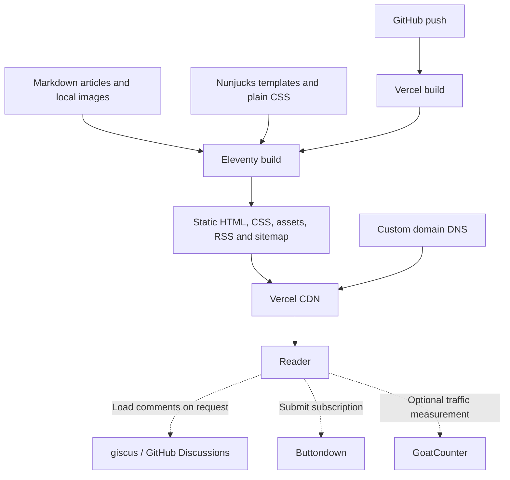

# Margin notes

A personal blog styled as a black-and-white web notebook: dotted paper, an original ink-style drawing, serif writing, monospace labels, and raised old-web buttons. Built with Eleventy 3, Nunjucks, Markdown, and plain CSS. The visual design and article navigation do not require JavaScript.

**Current status:** local starter, not deployed. The six published articles, site name, section names, and About page are samples. Newsletter, comments, and analytics stay off until configured.

**Continuing in a new chat:** read [PROJECT_CONTEXT.md](PROJECT_CONTEXT.md) for repository identification, decisions, file-by-file review, verification results, and pending work. Open the current Git repository rather than an older local prototype.

## Run locally

Use Node.js LTS (22 or newer), npm, and a development folder approved by your organization.

```sh
npm ci
npm run dev
```

Open the URL printed by Eleventy (normally `http://localhost:8080`; it may choose another port if occupied). Stop a terminal-owned preview with Ctrl+C.

```sh
npm run check
```

This makes a fresh production-style build in `_site` and runs Node's built-in tests. `npm test` alone expects an existing build. Do not run a clean build while the preview server is running; stop it first and restart afterwards.

Use an approved development location and follow your environment's execution policies.

## Architecture



There is no custom backend or database. Do not add service secrets to client-side code. The integrations here use public identifiers only.

## Make it yours

- Edit the title and description in [site data](src/_data/site.js).
- Edit the introduction and margin note in [the homepage](src/index.njk).
- Replace [the About page](src/about.md) with your own introduction.
- Rename and reorder themes in [section data](src/_data/sections.js). Each post must reference a valid section ID.
- Adjust colors, type, and spacing in [the stylesheet](src/assets/style.css).
- The authored palette is strictly black and white, including code styling and the favicon. Dots, hatching, borders, and type weight supply texture instead of extra colors. The [notebook drawing](src/assets/notebook.svg) is an original lightweight SVG; no Three.js, external fonts, or animation library is needed.
- Edit the sample blogroll and margin note in [the homepage](src/index.njk). External links are ordinary links, not third-party embeds.
- Replace the `m.` monogram in [the base layout](src/_includes/layouts/base.njk) and [favicon](src/assets/favicon.svg) if you change the identity.
- Replace/delete the sample articles. The sample disclaimer disappears when no published articles have `sample: true`.
- Review [privacy disclosures](src/privacy.njk) and add your contact information before launch.

## Write an article

Create a Markdown file directly inside [src/posts](src/posts) using this format:

```markdown
---
title: A thought worth keeping
slug: a-thought-worth-keeping
date: 2026-10-15
section: living
description: A short summary for the index, RSS, and search previews.
draft: true
featured: false
sample: false
---

Your article begins here.

## A heading

Write naturally. **Bold**, *italics*, lists, links, and fenced code blocks work.
```

- Supported sections initially: `living`, `learning`, `making`.
- Set `draft: false` to publish. Future dates do **not** schedule publication.
- The stable URL comes from the slug, not the filename or title. Keep it unchanged after publishing unless you also configure a redirect in Vercel.
- Dates use UTC. Use a YAML date, not a quoted relative expression.
- Set `featured: true` to feature an article; if several are featured, the newest wins. Otherwise the newest published article is featured.
- Raw HTML is supported in Markdown. Author only trusted content.
- Metadata errors stop the build instead of producing broken pages.
- Restart the dev server after deleting an article or changing it to a draft. A restart/full build cleans stale output.
- A draft is excluded from output, not hidden from your Git repository's readers. Use a private source repository if needed.

Tests derive published article counts, URLs, archive years, and feed order from generated output rather than requiring specific sample titles or a fixed post count. Code rendering and configured integrations use an in-memory template fixture that is never published. The included `draft-example` remains an explicit draft-exclusion check; update that check if you intentionally publish that particular template.

The samples exercise long titles, lists, a blockquote, an SVG figure with a caption, code, a table, and a second archive year. They are clearly labeled as sample writing, not claims about the site owner.

### Images

Put optimized images in `src/assets/images` (create the folder when needed). Reference them with `/assets/images/filename.webp`. Resize large images before adding them; this starter does not yet automate image processing.

Use descriptive alt text. For explicit dimensions and lazy loading:

```html

```

Only use images you own or have permission to publish. The site uses system fonts and no stock images.

## Connect optional services

Set variables in Vercel project settings, then redeploy. For local testing, set them in your shell before starting the server. `.env` files are **not** automatically loaded. [.env.example](.env.example) lists the expected names.

### Buttondown

Create your newsletter and set `BUTTONDOWN_USERNAME` to its public username. The native HTML signup form submits directly to Buttondown. Verify the subscription and confirmation flow using your own address.

Sending newsletters is separate from collecting subscriptions: publish the article, then send a newsletter manually from Buttondown. Check current service pricing and limits.

### giscus

Use the configurator at <https://giscus.app> after installing the giscus GitHub app on a public repository with Discussions enabled. A separate public comments repository works even if your source repository is private.

Copy these public values:

- `GISCUS_REPO`: `owner/repository`
- `GISCUS_REPO_ID`
- `GISCUS_CATEGORY`
- `GISCUS_CATEGORY_ID`

Configure all four together; partial configuration fails the build. Comments use the article's stable slug as a specific discussion term, so a domain change will not create a new discussion. Readers must select **Load comments** before any giscus script is requested. Posting requires GitHub login. Moderate discussions through GitHub.

### GoatCounter

Create a hosted GoatCounter site and set `GOATCOUNTER_CODE` to the subdomain portion of its `code.goatcounter.com` address. The script is currently gated by the site's indexing state: localhost origins and Vercel preview builds suppress it. Known limitation: setting a real `SITE_URL` during local development can enable it. Keep `GOATCOUNTER_CODE` unset locally until explicit build-environment gating is implemented.

Review your actual privacy obligations and service settings. Privacy-friendly does not mean no data processing.

## Deploy on Vercel

1. Replace sample content and complete the privacy page.
2. Push the project to your GitHub repository. This project's configured origin is `https://github.com/shiv292003/myblog.git`; use `git status` and `git remote -v` to confirm your local setup before pushing.
3. Import the repository in your Vercel account. [vercel.json](vercel.json) defines `npm ci`, `npm run build`, and `_site`.
4. Select a supported Node.js LTS runtime in Vercel.
5. Set `SITE_URL` to your final HTTPS origin, e.g. `https://yourname.com` (no subpath).
6. Add service identifiers only when their accounts are ready.
7. Deploy; check all pages, RSS, subscriptions, comments, and analytics.
8. Register your domain, add it in Vercel, and follow Vercel's DNS instructions. Choose one canonical domain and redirect alternatives.
9. Set two-factor authentication, store recovery codes safely, and enable domain renewal reminders.

Without `SITE_URL`, Vercel's production project hostname is used when available. Outside Vercel the fallback is `http://localhost:8080`, with a build warning and noindex directives. Preview builds are noindex, but **not private**; use access protection if needed.

RSS currently publishes article summaries and links. Social previews include title and description; a custom share image is not included yet.

## Maintenance and known limitations

- Commit the lockfile. Review dependency updates and rerun `npm run check`.
- Rechecked on 2026-10-17: `npm audit` still reports 9 build-tool dependency advisories (5 high, 4 moderate) in the installed tree. Eleventy 3.1.7 is now available within the existing version range (3.1.6 is installed), and audit reports fix availability. Evaluate the patch, rebuild/test, and rerun audit rather than assuming all findings are resolved. No dependency changes were applied during that review. These packages are not shipped in the static site, but build/development risk still exists.
- Keep a separate repository backup and export newsletter subscribers/discussions as appropriate.
- Domain renewal and service costs are your responsibility.
- There is no automatic newsletter sending, image optimization, search, scheduled publishing, or CMS.
- Account-backed integration behavior must be verified with your real service configuration; test builds do not send email, comments, or analytics events.
- Accessibility foundations include semantic landmarks, keyboard focus, a skip link, responsive type, reduced-motion handling, and print styles. Perform a real keyboard/mobile check when changing the design.
